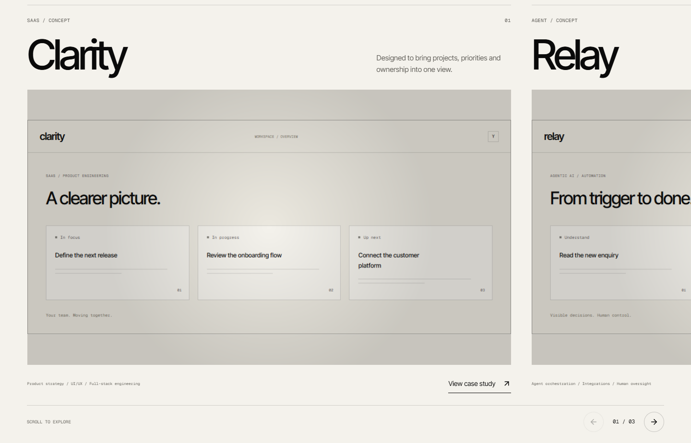

# Pass 3 — service stories and editorial Work

The six Practice tabs now demonstrate the service. Each desktop narrative runs for 5.6 seconds after its actual source canvas is ready, then keeps native pointer interaction. The left copy and 80vh stage remain. Captions follow authored beat times, rather than equal-length intervals. Replay resets the story; scrolling away or hiding the document pauses it.

Work now uses three 70vw editorial panels with captured concept interfaces, native image-spotlight, case-study dialogs and a bottom-right progress counter. Desktop page scrolling translates a pinned horizontal track. Previous/next controls and keyboard focus can also bring a panel into view. Touch, smaller screens and reduced motion use an ordinary vertical layout.

[Open the screenshot viewer](index.html) · [Capture observations](report-results.json) · [Native final-frame observations](frames-results.json)

## Each tab, mid-sequence

These captures come from actual tab activation on the homepage, approximately 2.7–3 seconds into the story. The observed times are recorded in `report-results.json`. They are screenshots of the running sources, not generated images.

| Tab        | Story and real source                                                                                                                                                                                                        | Mid-sequence                 | Final frame                                                  |
| ---------- | ---------------------------------------------------------------------------------------------------------------------------------------------------------------------------------------------------------------------------- | ---------------------------- | ------------------------------------------------------------ |
| Web        | Native dither cells sample a website mask: noise → wireframe → styled browser → page scroll and button click. Hover ripples continue through the final interface.                                                            | [Web](tab-web-mid.png)       | [Live website](../../public/frames/stories/web.png)          |
| SaaS       | The native liquid ripple simulation warps a dashboard surface. Bars rise, the line graph draws, KPI tiles emphasize, and New tenant produces three workspaces.                                                               | [SaaS](tab-saas-mid.png)     | [Three workspaces](../../public/frames/stories/saas.png)     |
| Agentic AI | The real glossy sphere absorbs labelled Email, CRM, Calendar, Docs and Slack chips, deforms while reasoning and emits a completed-task card. Three different tasks cycle after an idle period.                               | [Agentic AI](tab-ai-mid.png) | [Completed task](../../public/frames/stories/ai.png)         |
| Mobile     | The native dither source assembles the app inside a phone frame. It swipes through Today, Activity and You, then receives a notification.                                                                                    | [Mobile](tab-mobile-mid.png) | [Notification](../../public/frames/stories/mobile.png)       |
| Cloud      | Native GL points and edges use 11 supplied stack nodes. An orange point follows a request and response route through CDN, Next.js, API, database and AI. Hover/focus highlights connections and shows a descriptive tooltip. | [Cloud](tab-cloud-mid.png)   | [Architecture](../../public/frames/stories/cloud.png)        |
| UI-UX      | A wireframe mask resolves into a polished screen; a scripted cursor adjusts the button radius and accent color. Native dither ripples remain interactive.                                                                    | [UI-UX](tab-design-mid.png)  | [Polished interface](../../public/frames/stories/design.png) |

Web's three fixed poses also show the transition clearly: [wireframe](web-wireframe.png), [build](web-build.png), [live](web-live.png). The noindex `/playground/story/[id]?time=…` route supplies reproducible poses for captures; it is excluded from the sitemap.

## Work



[Last desktop panel](work-last-panel.png) · [All three panels on mobile](work-mobile.png)

Clarity (SaaS), Relay (Agent) and Forma (Web) are explicitly labelled **Concept**. Their outcome lines describe design intent. The case-study dialogs explain the opportunity and approach without claiming client results. Existing original UI mockups are used; there are no invented client screenshots or project metrics.

The stacked-carousel, inward rotation and orange radial-burst treatment have been removed from the production section. Shadow-cast was deliberately dropped to keep the interfaces and typography clear. The original sources remain available in the playground.

## Source changes and lifecycle

Three installed files have deliberate opt-in story extensions: `dithered-pixel-grid.tsx`, `liquid-grid.tsx`, and `network-lines.tsx`. Their original modes remain when the new inputs are absent. The exact changes are recorded in [fixes.md](../fixes.md). The sphere and image-spotlight use their installed source without changes this pass. No component failed or was moved into a placeholder slot.

Interface recipes live in `lib/service-story-canvas.ts`; the shared input types live in `lib/service-story-types.ts`. All authored labels, demo data and timing captions are in `content/site.ts`. The masks paint ordinary product UI and feed the real component; they do not imitate a missing visual effect.

Animation code is dynamically imported only after Services enters the viewport on an eligible desktop. One selected renderer mounts at a time, through the existing two-WebGL-context budget. Off-screen and hidden-document renderers unmount; the story clock resumes at its saved time. Mobile and reduced-motion visitors receive the captured final scene with semantic descriptions and zero effect canvases. The Work track also becomes vertical for these visitors.

Services and Work navigation links have explicit transparent backgrounds for hover, focus and active states, with the same orange underline as the other links.

## Verification

The production build and browser checks pass. The full 14-test suite covers native rendering, all service tabs and tab keyboard controls, stone-intro behavior, context budget, horizontal Work scrolling, case-study dialogs, FAQ, contact validation/API behavior, SEO and reduced-motion/mobile layouts. The focused Pass 3 tests also verify clock pause/resume and replay, Cloud keyboard tooltips, transparent nav backgrounds, final frame loading and absence of horizontal overflow.

Capture runs record no application console errors or uncaught exceptions. The final audited scores are recorded in [lighthouse-results.json](../lighthouse-results.json); detailed local reports are in `artifacts/`. The screenshot report does not constitute testing on every physical GPU or device.

Mobile Lighthouse scores are **90 / 100 / 100 / 100** for the homepage and **93 / 100 / 100 / 100** for Contact (performance / accessibility / best practices / SEO), with zero layout shift. Initial runs were below the performance target. Viewport-only story imports and frame loading, avoiding mobile pin measurement, deferring contact form prefetch and consolidating Inter Tight into its same-family variable font reduced the first-load cost. The three old Inter Tight weight files total 67,292 bytes; the variable file is 44,872 bytes. Font licenses and the preparation script are retained.

To reproduce against `npm start`:

```sh
npm run capture:stories:frames
# Restart the preview after generating new public assets.
npm run capture:pass3
npm run test:e2e
npm run audit
```

## Assets and remaining boundaries

Architecture marks in `public/stack/` come from the [Simple Icons package](https://github.com/simple-icons/simple-icons): current icons via `https://cdn.simpleicons.org/<slug>`, with OpenAI and AWS marks from the official package's version 11 SVG files on jsDelivr. They are recolored paper, served locally and paired with readable labels. These marks identify the depicted technologies; they are not customer endorsements.

The service stories and agent task outputs are scripted demonstrations. Live CRM/calendar integrations, real client case studies and verified company proof data were not added. Contact delivery still needs the existing Resend configuration. No production deployment or Git push was performed in this pass.
